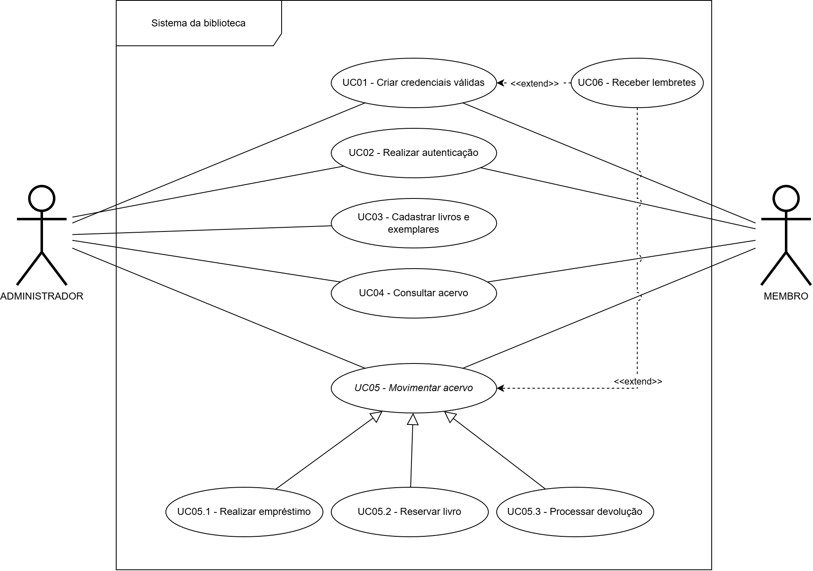

# Casos de uso

O diagrama abaixo ilustra os principais casos de uso:

## Índice

- [UC01 - Criar credenciais válidas](UC01-criar-credenciais-validas.md)
- [UC02 - Realizar autenticação](UC02-realizar-autenticacao.md)
- [UC03 - Gerenciar acervo (abstrato)](UC03-gerenciar-acervo.md)
  - [UC03.1 - Cadastrar livro](UC03.1-cadastrar-livro.md)
  - [UC03.2 - Cadastrar exemplar](UC03.2-cadastrar-exemplar.md)
  - [UC03.3 - Atualizar livro](UC03.3-atualizar-livro.md)
  - [UC03.4 - Atualizar exemplar](UC03.4-atualizar-exemplar.md)
  - [UC03.5 - Remover livro](UC03.5-remover-livro.md)
  - [UC03.6 - Remover exemplar](UC03.6-remover-exemplar.md)
- [UC04 - Consultar acervo](UC04-consultar-acervo.md)
- UC05 - Movimentar acervo (abstrato)
  - UC05.1 - Realizar empréstimo
  - UC05.2 - Reservar livro
  - UC05.3 - Processar devolução
- UC06 - Receber lembretes
- UC07 - Solicitar recuperação de credenciais (login ou senha)
- UC08 - Recuperar a conta bloqueada