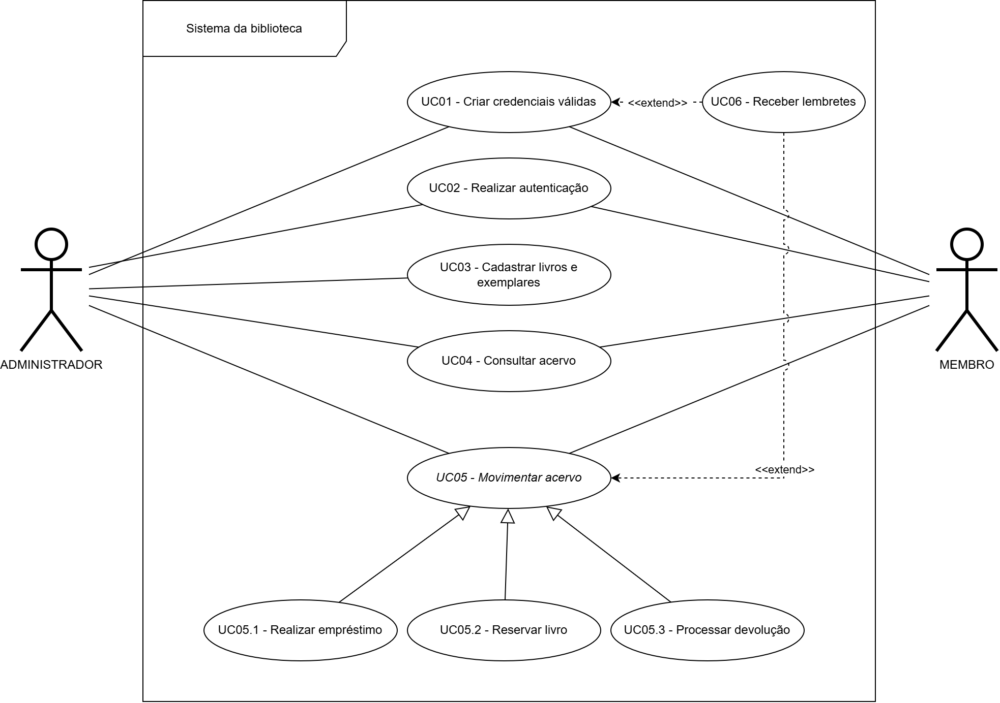

# Casos de uso

O diagrama abaixo ilustra os principais casos de uso:

## Índice

- [UC01 - Criar credenciais válidas](UC01-criar-credenciais-validas.md)
- [UC02 - Realizar autenticação](UC02-realizar-autenticacao.md)
- [UC03 - Cadastrar livros e exemplares](UC03-gerenciar-livros-e-exemplares.md)
- [UC04 - Consultar acervo](UC04-consultar-acervo.md)
- UC05 - Movimentar acervo (abstrato)
  - UC05.1 - Realizar empréstimo
  - UC05.2 - Reservar livro
  - UC05.3 - Processar devolução
- UC06 - Receber lembretes
