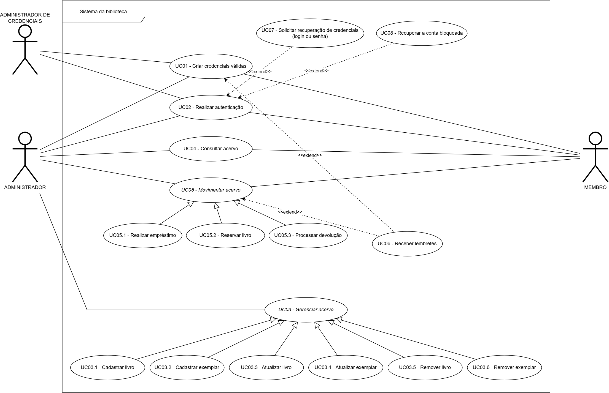
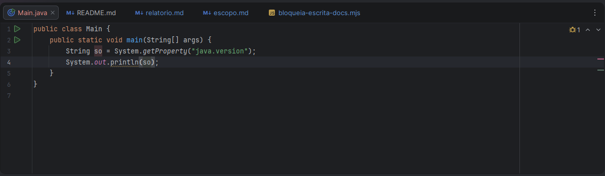
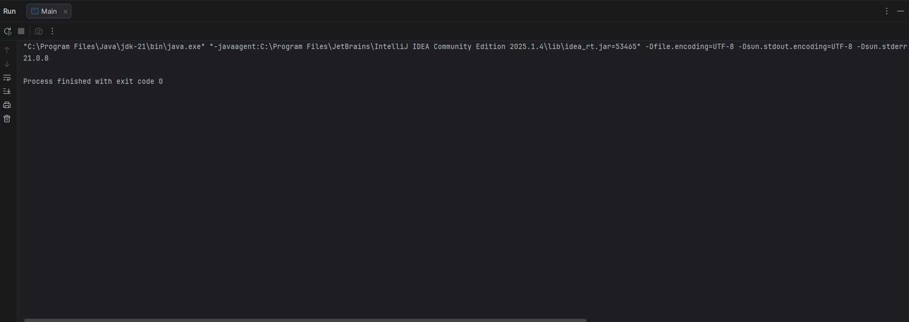
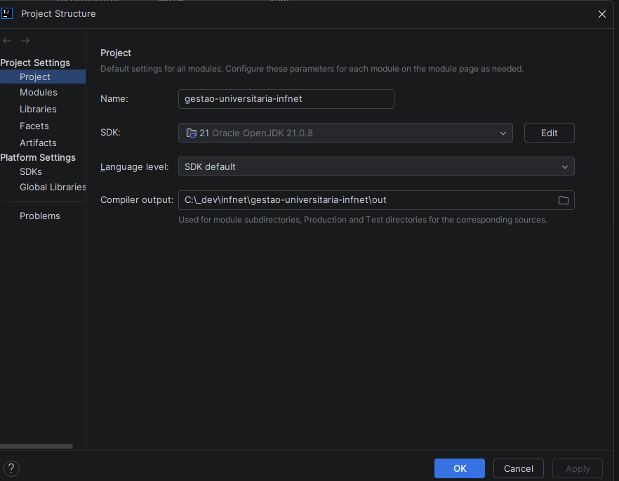

# TP1 DO Projeto de Bloco: Desenvolvimento Back-End [26E4_5]
Aluno: Diogo de Souza Medeiros
Data: 20 de novembro de 2026
Professor: Orlando Fonseca Guilarte
Instituto INFNET
Link para o repositório: https://github.com/ddmdros/gestao-universitaria-infnet

## Introdução

Projeto avaliativo integrado à disciplina de Projeto de Bloco do curso de Engenharia de Software. Neste projeto, o aluno deve desenvolver um sistema para uma biblioteca universitária fictícia. Neste primeiro TP, a entrega consiste principalmente no levantamento de requisitos e no primeiro esboço de um projeto standalone.

## Processo

Retirei informações do texto fornecido pelo TP para criar **Atores**, **Entidades** e **RNs**.

A partir dessas informações, comecei a trabalhar nos **RF**, **RNF**, **diagramas** e **casos de uso**.

Durante a modelagem desses requisitos, surgiram dúvidas, tomei decisões e identifiquei problemas que serão resolvidos depois. Por isso:
- Dúvidas viram OQxx (EX OQ01)
- Decisões viram Dxx (ex D01)
- O que está aberto vira Pxx (ex P01)

## Requisitos

### Glossário

Registra e define termos relevantes ao projeto para evitar ambiguidades.

**Livro**: objeto textual composto por título, autor e ISBN. É uma entidade mais abstrata, pois não se refere a um livro físico.

**Exemplar**: entidade física correspondente a um livro no acervo da biblioteca. A biblioteca pode possuir diversos exemplares de um mesmo livro.

**Membro**: Usuários finais do sistema da biblioteca: aluno, professor ou funcionário. Ver A01.

**Administrador**: Responsável pelas atividades administrativas do sistema da biblioteca. Ver A02.

**Aposentado**: removido do acervo de forma definitiva por motivos variados

**Condição adequada**: estado de conservação conservado (RN04, RF16)

**Disponível**: condição adequada e sem empréstimo ativo (RN04, RN06, RF28, D02)

### Atores

Fonte: [enunciado TP](enunciado.md).

| ID | Nome | Entidades | Papel |
|---|---|---|---|
| A01 | Membro | Membro | Pode consultar o acervo, verificar a disponibilidade dos livros, solicitar empréstimos e devoluções e realizar reservas|
| A02 | Administrador (ver [`D03`](justificativas/decisoes.md)) |  | Responsável por cadastrar, consultar, atualizar e remover registros do acervo e dos membros, processar empréstimos e devoluções, gerenciar reservas e multas por atraso |

### Entidades

Fonte: [enunciado TP](enunciado.md).

| ID | Nome | Atributos | Relacionados |
|---|---|---|---|
| E01 | Livro | título, autor e ISBN| |
| E02 | Exemplar | código de patrimônio, estado de conservação (conservado, danificado, em_reparo, aposentado) | vínculo com um Livro |
| E03 | Empréstimo | membro, data de retirada, prazo de devolução e data efetiva de devolução | Exemplar |
| E04 | Reserva | membro e data da reserva | Livro |
| E05 | Multa | membro, valor e situação de pagamento | Empréstimo |
| E06 | Membro | nome, matrícula e tipo (aluno, professor ou funcionário) | |

### Regras de Negócio (RN)

As regras de negócio de RN01-RN12 foram fornecidas pelo enunciado do TP1 e foram preservadas em sua integralidade, incluindo a ordem em que foram apresentadas. Aqui, apenas acrescentamos um ID e as organizamos em módulos para facilitar sua identificação. As demais foram decisões tomadas pela equipe.

Fonte: [enunciado TP](enunciado.md).

| ID | Descrição | Módulo |
|---|---|---|
| RN01 | O prazo padrão de cada empréstimo é de 14 dias corridos a partir da data de retirada. | Empréstimo e devolução |
| RN02 | A multa por atraso é calculada por dia corrido após o prazo de devolução, considerando apenas os dias de atraso até a devolução efetiva do exemplar. | Multa |
| RN03 | Cada membro pode ter, no máximo, 3 empréstimos simultâneos ativos. | Empréstimo e devolução |
| RN04 | Um exemplar somente pode ser emprestado se estiver disponível e em condições adequadas de uso. | Empréstimo e devolução |
| RN05 | Um exemplar não pode possuir mais de um empréstimo ativo simultaneamente. | Empréstimo e devolução |
| RN06 | A reserva somente pode ser realizada para um livro que possua exemplares atualmente emprestados, não sendo permitida a reserva quando todos os exemplares estiverem disponíveis. | Reserva |
| RN07 | A reserva é vinculada ao livro, e não a um exemplar específico, pois pode haver vários exemplares do mesmo título no acervo.| Reserva |
| RN08 | A devolução deve encerrar o empréstimo ativo correspondente e registrar a data efetiva de devolução.| Empréstimo e devolução  |
| RN09 | Quando a devolução ocorrer após o prazo estabelecido, o sistema deverá calcular a multa proporcional aos dias corridos de atraso e vinculá-la ao membro responsável pelo empréstimo.| Multa |
| RN10 | Exemplares danificados ou indisponíveis para uso não podem ser emprestados até que sua condição seja regularizada pelo bibliotecário. | Acervo |
| RN11 | Somente o Bibliotecário/Administrador pode cadastrar ou alterar os registros do acervo e dos membros, processar operações administrativas e gerenciar multas. | Transversal (acesso do adm) |
| RN12 | Os membros devem possuir cadastro válido para realizar empréstimos e reservas.| Membros |
| RN13 | Documentos válidos para criação de credenciais (D07):  Estudante: atestado de matrícula/histórico escolar recente (últimos 3 meses) Professor: contracheque recente (últimos 3 meses) Funcionário: contracheque recente (últimos 3 meses) Bibliotecário e administrador de credenciais: contracheque recente (últimos 3 meses)| Credenciais |

### Requisitos funcionais (RF)

#### Acervo (cadastro antes do uso)

| ID   | Requisito funcional                                                              | Origem         |
| ---  | ---                                                                              | ---            |
| RF01 | O sistema deve permitir que somente o administrador cadastre livros no acervo | RN11, A02, D04 |
| RF02 | O sistema deve permitir que somente o administrador cadastre exemplares no acervo | RN11, A02, D04 |
| RF03 | O sistema deve permitir que membros e administradores consultem livros do acervo | RN11, A01, A02 |
| RF04 | O sistema deve permitir que membros e administradores consultem exemplares do acervo | RN11, A01, A02 |
| RF05 | O sistema deve permitir que, dado um livro, os membros consultem a disponibilidade de exemplares | A01 |
| RF06 | O sistema deve permitir que somente o administrador atualize os atributos de livros e exemplares,  inclusive o estado de conservação do exemplar. | RN11, A02, D04, RN10, RF16 |
| ~~RF07~~ | ~~O sistema deve permitir que somente o administrador atualize o estado de conservação de um exemplar~~ *(fundido no RF06)* | ~~RN10, RF16~~ |
| RF08 | O sistema deve permitir que somente o administrador remova livros e exemplares do acervo | RN11, A02, D04 |

#### Membros

| ID   | Requisito funcional                                                              | Origem         |
| ---  | ---                                                                              | ---            |
| RF09 | O sistema deve permitir que somente o administrador cadastre registros dos membros | RN11, A02, D04 |
| RF10 | O sistema deve permitir que o administrador consulte registros dos membros | RN11, A02, D04 |
| RF11 | O sistema deve permitir que somente o administrador atualize registros dos membros | RN11, A02, D04 |
| RF12 | O sistema deve permitir que somente o administrador remova registros dos membros | RN11, D04, A02 |
| RF13 | O sistema deve impedir que membros sem cadastro válido realizem empréstimos ou reservas | RN12 |

#### Realizar um empréstimo

| ID   | Requisito funcional                                                              | Origem         |
| ---  | ---                                                                              | ---            |
| RF14 | O sistema deve permitir que os membros solicitem empréstimos | A01 |
| RF15 | O sistema deve recusar o empréstimo quando o membro tiver 3 empréstimos simultâneos ativos. | RN03 |
| RF16 | O sistema deve recusar o empréstimo de exemplar em condição inadequada | RN04 |
| RF17 | O sistema deve recusar o empréstimo de um exemplar emprestado | RN05 |
| RF18 | O sistema deve permitir que somente o administrador processe empréstimos | RN11, A02, D05 |
| RF19 | O sistema deve calcular o prazo de 14 dias corridos de devolução automaticamente quando um empréstimo é realizado. A data de retirada é o dia 0, e não contabiliza para os 14 dias corridos do prazo de devolução. | RN01, D01 |

#### Processar devolução

| ID   | Requisito funcional                                                              | Origem         |
| ---  | ---                                                                              | ---            |
| RF20 | O sistema deve permitir que os membros solicitem devoluções | A01 |
| RF21 | O sistema deve permitir que somente o administrador processe devoluções | RN11, A02, D05 |
| RF22 | O sistema deve encerrar o empréstimo ativo correspondente quando uma devolução for realizada | RN08 |
| RF23 | O sistema deve registrar a data efetiva de devolução automaticamente quando uma devolução for realizada | RN08 |

#### Multa (consequência da devolução)

| ID | Requisito funcional | Origem |
|---|---|---|
| RF24 | O sistema deve calcular a multa automaticamente quando um exemplar é devolvido com atraso. | RN02, RF19 |
| RF25 | O sistema deve vincular a multa por atraso ao membro responsável pelo empréstimo | RN09, RF19 |
| RF26 | O sistema deve permitir que o administrador consulte multas de membros | RN11, A02, OQ01, D06 |
| RF27 | O sistema deve permitir que o administrador marque uma multa como paga. | RN11, A02, OQ01|

#### Reserva

| ID | Requisito funcional | Origem |
|---|---|---|
| RF28 | O sistema deve permitir que um livro possa ser reservado somente quando pelo menos 1 exemplar estiver emprestado e não houver nenhum exemplar correspondente disponível. (ver `D02`) | RN06, D02 |
| RF29 | O sistema deve permitir que os membros e o administrador criem uma reserva. | RN11, A01, A02, OQ02 |
| RF30 | O sistema deve permitir que o administrador consulte uma fila de reserva. | RN11, A02, OQ02 |
| RF31 | O sistema deve permitir que o administrador cancele um registro de uma fila de reserva. | RN11, A02, OQ02 |

#### Verificação e login

| ID | Requisito funcional | Origem |
|---|---|---|
| RF32 | O administrador de credenciais deve ser capaz de criar e modificar credenciais para os membros e administradores (incluindo bibliotecarios e os próprios administradores de credenciais) | UC01 |
| RF34 | O sistema deve permitir que o membro e o administrador forneçam suas credenciais de acesso ao sistema | UC01 |
| RF35 | O sistema deve ser capaz de validar as credenciais de acesso de membros e administradores aos sistema  | UC01 |
| RF36 | O sistema deve fornecer métodos de recuperação de acesso de credenciais caso o membro ou administrador esqueça das suas credenciais | UC07 |
| RF37 | O sistema deve validar de forma automática se o vínculo do membro ou administrador com a universidade continua ativo | UC02 |
| RF38 | O sistema deve bloquear a autenticação de acesso do membro ou administrador que está há mais de seis meses afastado da universidade. | UC02 |
| RF39 | O sistema deve bloquear o acesso do membro ou administrador após errar 5 tentativas de login | UC02 |
| RF40 | O sistema deve permitir que o membro ou administrador recupere a conta bloqueada | UC08 |

### Requisitos não funcionais (RNF)

| ID | Requisito não funcional | Categoria | Justificativa |
| --- | --- | --- | --- |
| RNF01 | Com até 50 usuários simultâneos, uma solicitação de consulta, reserva ou empréstimo no sistema deve responder em até 0,5s em 95% das vezes | Desempenho | Essas são as operações básicas do sistema, e o sistema não deve demorar para realizá-las. O número de 50 usuários simultâneos é uma estimativa de quantas pessoas podem usar o sistema de uma biblioteca universitária em horário de pico (D09). |
| RNF02 | O sistema deve garantir que os dados de uma operação de reserva, empréstimo ou devolução concluída não sejam perdidos quando houver falha no sistema. | Confiabilidade | Se o programa cair, reiniciar ou falhar após uma operação, os registros não devem se perder, pois o membro ou administrador pode levar uma multa ou sofrer penalidades indevidas. |
| RNF03 | O sistema deve estar em português. | Usabilidade | A biblioteca universitária está localizada no Brasil, então o idioma será o português. Novos idiomas podem ser adicionados no futuro. |
| RNF04 | Toda mensagem de erro deve informar o motivo e a ação seguinte a ser tomada. | Usabilidade | O sistema será usado por pessoas não técnicas, e é importante que, quando essas pessoas enfrentarem um erro, elas entendam o problema e saibam como agir. |
| RNF05 | O sistema deve ser desenvolvido com a JDK 21 (LTS) | Restrição tecnológica | Restrição imposta pelo TP |
| RNF06 | O sistema deve ocultar senhas por padrão. | Segurança | Em ambientes públicos como uma biblioteca, é importante que a senha não seja exposta. |

## Casos de uso

O diagrama abaixo ilustra os principais casos de uso:

### Índice

- [UC01 - Criar credenciais válidas](../../casos-de-uso/UC01-criar-credenciais-validas.md)
- [UC02 - Realizar autenticação](../../casos-de-uso/UC02-realizar-autenticacao.md)
- [UC03 - Gerenciar acervo (abstrato)](../../casos-de-uso/UC03-gerenciar-acervo.md)
  - [UC03.1 - Cadastrar livro](../../casos-de-uso/UC03.1-cadastrar-livro.md)
  - [UC03.2 - Cadastrar exemplar](../../casos-de-uso/UC03.2-cadastrar-exemplar.md)
  - [UC03.3 - Atualizar livro](../../casos-de-uso/UC03.3-atualizar-livro.md)
  - [UC03.4 - Atualizar exemplar](../../casos-de-uso/UC03.4-atualizar-exemplar.md)
  - [UC03.5 - Remover livro](../../casos-de-uso/UC03.5-remover-livro.md)
  - [UC03.6 - Remover exemplar](../../casos-de-uso/UC03.6-remover-exemplar.md)
- [UC04 - Consultar acervo](../../casos-de-uso/UC04-consultar-acervo.md)
- UC05 - Movimentar acervo (abstrato)
  - UC05.1 - Realizar empréstimo
  - UC05.2 - Reservar livro
  - UC05.3 - Processar devolução
- UC06 - Receber lembretes
- UC07 - Solicitar recuperação de credenciais (login ou senha)
- UC08 - Recuperar a conta bloqueada

### UC01 - Criar credenciais válidas

**Ator principal:** membro ou administrador

**Ator secundário:** administrador de credenciais

#### Resumo

O administrador de credenciais cria credenciais válidas para o administrador ou membro solicitante

#### Pré-condições

1. Um administrador do tipo administrador de credenciais válido
2. Um membro ou administrador solicitante

#### Pós-condições

1. O membro ou administrador solicitante agora possui credenciais válidas
2. Se solicitado, o solicitante pode receber notificações (UC06)

#### Cenário principal

1. O membro ou administrador envia uma solicitação de criação de credenciais para o administrador de credenciais com os documentos que comprovam o seu vínculo com a universidade (RN13)
2. O administrador de credenciais valida e aprova os documentos
3. O administrador de credenciais cria as credenciais do solicitante
4. Se solicitado, o solicitante pode receber uma notificação comprovando a operação (UC06)

#### Fluxos alternativos

- 2a. O administrador de credenciais recusa o(s) documento(s) fornecido(s)
  - 2a1. O membro ou administrador deve buscar os documentos válidos e só então voltar ao passo 1

### UC02 - Realizar autenticação

**Ator principal:** membro ou administrador

#### Resumo

O membro ou administrador insere suas credenciais no sistema, que faz a validação.

#### Pré-condições

1. O membro ou administrador solicitante possui credenciais válidas (ver UC01).

#### Pós-condições

1. O membro ou administrador agora tem acesso ao sistema.
2. Se solicitado, o membro ou administrador solicitante pode receber uma notificação confirmando a operação.

#### Cenário principal

1. O membro ou administrador solicitante insere suas credenciais de acesso no sistema
2. O sistema valida a autenticação do membro ou administrador no sistema

#### Fluxos alternativos

- 1a. O membro ou administrador não lembra das suas credenciais ou parte dela (usuário ou senha).
  - 1a1. O membro ou administrador pode solicitar a recuperação das suas credenciais através do sistema
    - 1a1.1. O membro ou administrador encerra o UC02 e passa para o UC07
- 2a. O membro ou administrador forneceu credenciais inválidas
  - 2a1. O membro ou administrador pode tentar inserir suas credenciais novamente (o membro ou administrador pode errar até 5 vezes)
    - 2a1.1. Se exceder o limite de tentativas, o sistema bloqueia a conta, e o membro ou administrador encerra o UC02 e deve iniciar o UC08 para recuperar a conta
    - 2a1.2. Se acertar as credenciais em uma das tentativas, a contagem das tentativas zera, e o membro ou administrador conclui o passo 2
  - 2a2. O membro ou administrador pode solicitar a recuperação das suas credenciais através do sistema
    - 2a2.1. O membro ou administrador encerra o UC02 e passa para o UC07
- 2b. O membro ou administrador está há mais de seis meses afastado da universidade (RF38)
  - 2b1. O membro ou administrador deve enviar os documentos comprobatórios para o administrador de credenciais para atualizar suas credenciais
    - 2b1.1. O membro ou administrador encerra o UC02 e passa para o UC01

### UC03 - Gerenciar acervo (abstrato)

**Ator principal:** administrador

#### Resumo

O administrador realiza operações de cadastro, atualização e remoção em livros e exemplares no sistema, e as operações são refletidas para membros e administradores.

#### Pré-condições

1. Administrador autenticado (UC02, RN11)

#### Especializações

- [UC03.1 - Cadastrar livro](../../casos-de-uso/UC03.1-cadastrar-livro.md)
- [UC03.2 - Cadastrar exemplar](../../casos-de-uso/UC03.2-cadastrar-exemplar.md)
- [UC03.3 - Atualizar livro](../../casos-de-uso/UC03.3-atualizar-livro.md)
- [UC03.4 - Atualizar exemplar](../../casos-de-uso/UC03.4-atualizar-exemplar.md)
- [UC03.5 - Remover livro](../../casos-de-uso/UC03.5-remover-livro.md)
- [UC03.6 - Remover exemplar](../../casos-de-uso/UC03.6-remover-exemplar.md)

#### Regras e requisitos

##### Comuns a todas as especializações

| Referência | Descrição |
|---|---|
| RN11 | Somente o administrador pode cadastrar ou alterar os registros do acervo |
| D04 | Operações do acervo tratadas de forma granular (cadastrar, atualizar, remover) |
| E01, E02 | Atributos de livro e exemplar |
| P15 | Atributo identificador de livro e exemplar (pendente) |

##### Por especialização

| Referência | Descrição | Especializações |
|---|---|---|
| RF01 | Cadastro de livros | UC03.1 |
| RF02 | Cadastro de exemplares | UC03.2 |
| RF06 | Atualização de livros e exemplares, inclusive estado de conservação | UC03.3, UC03.4 |
| RF08 | Remoção de livros e exemplares | UC03.5, UC03.6 |
| P14 | Campos obrigatórios de livro e exemplar (pendente) | UC03.1 a UC03.4 |
| D08 | Remoção em cascata (livro) ou um a um (exemplar) | UC03.5, UC03.6 |

### UC03.1 - Cadastrar livro

**Ator principal:** administrador

#### Resumo

O administrador realiza o cadastro de um livro, o sistema registra-o corretamente no sistema

#### Pré-condições

1. Administrador autenticado (UC02, RN11)

#### Pós-condições

1. O livro é cadastrado no sistema

#### Cenário principal

1. O administrador insere as informações do livro que deseja cadastrar (E01)
2. O sistema verifica se todos os campos obrigatórios foram informados (P14)
3. O sistema verifica se o administrador não está tentando cadastrar um livro duplicado (P15)
4. O sistema registra os dados no sistema (RF01)
5. O sistema exibe uma mensagem de que o livro foi cadastrado corretamente

#### Fluxos alternativos

- 2a. O administrador não preencheu todos os campos obrigatórios
  - 2a1. O sistema indica quais campos obrigatórios não foram preenchidos
  - 2a2. O administrador volta ao passo 1
- 3a. O administrador tenta cadastrar um livro já cadastrado
  - 3a1. O sistema informa que o livro já está cadastrado, e o administrador volta para o passo 1

### UC03.2 - Cadastrar exemplar

**Ator principal:** administrador

#### Resumo

O administrador realiza o cadastro de um exemplar, o sistema registra-o corretamente no sistema

#### Pré-condições

1. Administrador autenticado (UC02, RN11)

#### Pós-condições

1. O exemplar é cadastrado no sistema

#### Cenário principal

1. O administrador insere as informações do exemplar que deseja cadastrar (E02)
2. O sistema verifica se todos os campos obrigatórios foram informados (P14)
3. O sistema verifica se há um livro correspondente ao exemplar cadastrado
4. O sistema verifica se o administrador não está tentando cadastrar um exemplar duplicado (P15)
5. O sistema registra os dados no sistema (RF02)
6. O sistema exibe uma mensagem de que o exemplar foi cadastrado corretamente

#### Fluxos alternativos

- 2a. O administrador não preencheu todos os campos obrigatórios
  - 2a1. O sistema indica quais campos obrigatórios não foram preenchidos
  - 2a2. O administrador volta ao passo 1
- 3a. O administrador está tentando cadastrar um exemplar que não tem um livro correspondente
  - 3a1. O sistema avisa o administrador de que ele deve realizar o cadastro do livro antes de cadastrar o exemplar
  - 3a2. O administrador encerra o UC03.2 e recebe a sugestão de iniciar um UC03.1 no lugar
- 4a. O administrador tenta cadastrar um exemplar já cadastrado
  - 4a1. O sistema informa que o exemplar já está cadastrado, e o administrador volta para o passo 1

### UC03.3 - Atualizar livro

**Ator principal:** administrador

#### Resumo

O administrador atualiza informações de cadastro relacionadas a um livro, o sistema atualiza as informações corretamente no sistema

#### Pré-condições

1. Administrador autenticado (UC02, RN11)

#### Pós-condições

1. As informações cadastrais do livro são corretamente atualizadas no sistema

#### Cenário principal

1. O administrador informa o livro cuja informação ou informações cadastrais deseja atualizar (P15)
2. O sistema verifica se há livro correspondente ao informado
3. O administrador informa a informação ou as informações cadastrais que deseja atualizar
4. O sistema verifica se, após a atualização, todos os campos obrigatórios foram informados (P14)
5. O sistema registra os dados no sistema (RF06)
6. O sistema exibe uma mensagem de que as informações cadastrais do livro foram atualizadas

#### Fluxos alternativos

- 2a. O administrador tenta atualizar informações de um livro não cadastrado
    - 2a1. O sistema avisa que não há livro correspondente cadastrado
    - 2a2. O administrador volta ao passo 1
- 4a. Ao atualizar as informações, o administrador não preencheu todos os campos obrigatórios
    - 4a1. O sistema avisa o administrador que ele não preencheu todos os campos obrigatórios, e identifica quais campos estão com problema
    - 4a2. O administrador volta ao passo 3

### UC03.4 - Atualizar exemplar

**Ator principal:** administrador

#### Resumo

O administrador atualiza informações de cadastro relacionadas a um exemplar, o sistema atualiza as informações corretamente no sistema

#### Pré-condições

1. Administrador autenticado (UC02, RN11)

#### Pós-condições

1. As informações cadastrais do exemplar são corretamente atualizadas no sistema

#### Cenário principal

1. O administrador informa o exemplar cuja informação ou informações cadastrais deseja atualizar (P15)
2. O sistema verifica se há exemplar correspondente ao informado
3. O administrador informa a informação ou as informações cadastrais que deseja atualizar
4. O sistema verifica se, após a atualização, todos os campos obrigatórios foram informados (P14)
5. O sistema registra os dados no sistema (RF06)
6. O sistema exibe uma mensagem de que as informações cadastrais do exemplar foram atualizadas

#### Fluxos alternativos

- 2a. O administrador tenta atualizar informações de um exemplar não cadastrado
  - 2a1. O sistema avisa que não há exemplar correspondente cadastrado
  - 2a2. O administrador volta ao passo 1
- 4a. Ao atualizar as informações, o administrador não preencheu todos os campos obrigatórios
  - 4a1. O sistema avisa o administrador que ele não preencheu todos os campos obrigatórios, e identifica quais campos estão com problema
  - 4a2. O administrador volta ao passo 3

### UC03.5 - Remover livro

**Ator principal:** administrador

#### Resumo

O administrador realiza a operação de remoção de um livro, e o sistema realiza a remoção com sucesso

#### Pré-condições

1. Administrador autenticado (UC02, RN11)

#### Pós-condições

1. O livro é removido do sistema

#### Cenário principal

1. O administrador informa o livro que deseja remover do sistema (P15)
2. O sistema verifica se o livro informado existe
3. O sistema verifica se há exemplares associados a esse livro
4. O sistema verifica se não há exemplares associados emprestados
5. O sistema informa o administrador a associação desse livro com outros exemplares: pode estar associado a outros ou não
6. O sistema pede a confirmação de exclusão do administrador
7. O administrador informa que deseja remover o livro do acervo
8. O sistema remove o livro e os exemplares associados (quando houver) do sistema (RF08, D08)
9. O sistema exibe uma mensagem de que o livro e os exemplares associados (quando houver) foram removidos do sistema

#### Fluxos alternativos

- 2a. O livro informado não existe
  - 2a1. O sistema informa o erro e o administrador volta ao passo 1
- 4a. Há exemplares associados emprestados
  - 4a1. O sistema informa o erro e o administrador volta ao passo 1. O livro só pode ser removido quando todos os exemplares forem devolvidos.
- 7a. O administrador desiste de realizar a remoção do livro
  - 7a1. O administrador volta ao passo 1

### UC03.6 - Remover exemplar

**Ator principal:** administrador

#### Resumo

O administrador realiza a operação de remoção de um exemplar, e o sistema realiza a remoção com sucesso

#### Pré-condições

1. Administrador autenticado (UC02, RN11)

#### Pós-condições

1. O exemplar é removido do sistema

#### Cenário principal

1. O administrador informa o exemplar que deseja remover do sistema (P15)
2. O sistema verifica se o exemplar está cadastrado
3. O sistema verifica se o exemplar não está emprestado
4. O sistema pede a confirmação de exclusão do administrador
5. O administrador informa que deseja remover o exemplar do acervo
6. O sistema remove o exemplar do sistema (RF08)
7. O sistema exibe uma mensagem de que o exemplar foi removido do sistema

#### Fluxos alternativos

- 2a. O exemplar não está cadastrado
  - 2a1. O sistema informa o erro, e o administrador volta ao passo 1
- 3a. O exemplar está emprestado
  - 3a1. O sistema informa o erro, e o administrador volta ao passo 1. O exemplar só pode ser excluído depois de ser devolvido.
- 5a. O administrador desiste de realizar a remoção do exemplar
  - 5a1. O administrador volta ao passo 1

## Escopo e suposições

### O que entrou no TP1, e por quê
- Requisitos: atores, entidades, RNs, RF01-RF40 e RNF01-RNF06: são os requisitos mais fundamentais do projeto, e o TP diz que ele será a base de todo o bloco. Me esforcei para ser detalhista aqui para evitar problemas futuros no desenvolvimento.
- Diagrama com todos os casos de uso: os diagramas antes do desenvolvimento ajudam a ter um panorama amplo do projeto, e desenhar todos os casos de uso ajuda nisso.
- Descrição de UC01, UC02 e UC03 e seus filhos (UC03.1 até UC03.6): segui a lógica da dependência: para fazer as principais atividades (emprestar, devolver, cobrar multa etc), é preciso autenticar, cadastrar e gerenciar o acervo. As outras ficaram para o próximo TP.
- Programa standalone simples, sem orientação a objeto: o enunciado pede tipos primitivos, operadores e controles de fluxo, sem orientação a objeto, então fiz um rascunho pequeno.

### O que ficou para depois
- UC04-UC08 (P13, P16): deixei os outros casos de uso para o próximo TP, pois dependem de autenticação e acervo prontos.
- Campos obrigatórios e identificador de livro e exemplar (P14, P15): impactam na modelagem de dados, fica melhor com diagramas de classes, no próximo TP
- Disponibilidade como RNF: como o projeto não será hospedado como um sistema real, fica difícil testar disponibilidade (ex.: com x usuários, o sistema deve ficar disponível y% do tempo). Por isso, foquei na persistência de dados, que é testável.
- Pendências abertas e dúvidas em aberto: P01, P06-P11, OQ04-OQ05: serão resolvidas nos próximos TPs, junto com o desenvolvimento dos próximos casos de uso e da modelagem de dados
- Persistência, API e autenticação real: o enunciado dos TPs já deixa claro que isso fica para as próximas etapas
- Rascunhos de UC04 e UC05.1: esses arquivos já estão no github, mas ainda são rascunhos e serão finalizados até a próxima entrega

#### Dúvidas em aberto

Ver [dúvidas em aberto](justificativas/duvidas.md) com estado "Aberto"

#### Pendências

Ver [Pendências](justificativas/pendencias.md) com estado "Aberto"

### Decisões

Mantém um registro das decisões e fundamentações baseadas em suposições.

| ID | Problema | Decisão adotada |
|---|---|---|
| D01  | A data de retirada entra na conta dos 14 dias corridos para a devolução? Origem: RF19 | A data de retirada é o dia 0, e não contabiliza para os 14 dias corridos para a devolução. |
| D02 | `RN06`: a reserva fica disponível quando TODOS os exemplares forem emprestados? Quando um livro tem 3 exemplares e 2 foram emprestados, pode fazer reserva? | Decidi que a reserva só pode acontecer quando não houver nenhum exemplar disponível. Esta decisão é mais estrita que a RN06 literal |
| D03 | A `RN11` usa "Bibliotecário/Administrador", e a `RN10` usa só "bibliotecário". Não há regras de permissões diferentes entre os dois. | Uniformizar como Administrador |
| D04 | o `RN11` diz que Administrador pode "cadastrar ou alterar" os registros do acervo e dos membros. O `A02` é mais granular, e cita cadastrar, atualizar, remover e consultar. Usei a especificação | Ser granular nos requisitos funcionais|
| D05 | O membro solicita o empréstimo, o administrador processa e registra, ou o membro faz tudo sozinho, como em um autoatendimento? | Decidi que o sistema emulará uma biblioteca física, e que, por isso, o administrador é o único que processa empréstimos e devoluções. |
| D06 | RN09 diz que o sistema calcula e vincula a multa, mas RN11 diz que o administrador gerencia a multa. | Decisão: o sistema cria a multa, e o administrador apenas consulta e marca como paga |
| D07 | É preciso decidir quais documentos comprovam vínculo com a universidade para a criação de credenciais válidas (UC01) | RN13 delimita os documentos necessários para comprovação de vínculo com a universidade. Pede-se que os documentos sejam recentes para comprovar que o membro ou admnistrador possui vínculo ativo com a universidade. |
| D08 | Ao remover um livro, os exemplares associados devem ser removidos um a um, ou o administrador pode remover em cascata? | UC03.5 (remover livro) permite remover em cascata: o administrador pode remover todos os exemplares associados a um livro ao remover um livro correspondente. UC03.6: o administrador pode remover um a um. Justificativa: o administrador pode precisar de agilidade na remoção. |
| D09 | RNF01 precisa de um valor testável para medir o desempenho do sistema: quantos usuários podem usar o sistema ao mesmo tempo em horário de pico? | Com base nas características do sistema (sistema de biblioteca universitária), estima-se que até 50 pessoas possam usar o sistema ao mesmo tempo em horário de pico. |

### Pendências

| ID | Pendência | Status | Comentário |
|---|---|---|---|
| P01 | RN07 não tem cobertura de RF  | Aberto | |
| P02 | ~~Conflito: quem cria a multa? O sistema? O administrador?~~ | Resolvido |  Resolvido pela D06: o sistema cria a multa, e o administrador apenas consulta e marca como paga |
| P03 | ~~RF19 não diz "14 dias" nem cita a D01. O RF24 também depende da D01 (dia 0), e a origem dele não a lista.~~ | Resolvido | RF19 foi atualizado |
| P04 | ~~RF07 só prevê "regularizar" a condição do exemplar. Nenhum RF prevê marcar um exemplar como danificado ou indisponível. O RF06 cobre isso de forma implícita.~~ | Resolvido | O RF06 passou a cobrir o estado de conservação, o RF07 foi fundido (ID mantido tachado) e a E02 ganhou os quatro estados |
| P05 | ~~RF28 usa "disponível" e a D02 usa "não danificado". Os dois precisam do mesmo termo no glossário.~~ | Resolvido | Termos adicionados ao glossário |
| P06 | Glossário. Os cinco termos adiados (condição adequada, disponível, empréstimo ativo, cadastro válido, solicitação) aparecem em RF13–RF17 e RF28. RNFs mensuráveis dependem deles. | Aberto | |
| P07 | Ciclo de vida da reserva: falta definir a ordem da fila e o que acontece na devoluição do livro reservado. E04 nao tem estado | Aberto | |
| P08 | Remoção (RF08, RF12) com pendências. Não está dito o que fazer ao remover um membro ou exemplar com empréstimo ativo, multa ou reserva. | Aberto | |
| P09 | Multa não paga. Ela bloqueia novos empréstimos? O enunciado não diz. Registrar como suposição. | Aberto | |
| P10 | Exemplar devolvido danificado. | Aberto | |
| P11 | Reservas duplicadas. Ex.: membro reservando um livro que ele mesmo já tem emprestado. | Aberto | |
| P12  | ~~Oito RFs dizem "somente administrador", mas nada foi definido sobre autenticação~~ | Resolvido | Seção de verificação e login criada em RF; distinçao entre bibliotecário e administrador de credenciais criada |
| P13 | Falta criar os UC07 e 08 | Aberto | Fica para o TP2 |
| P14 | Definir campos obrigatórios de livro e exemplar | Aberto | Fica para o TP2 |
| P15 | Definir por qual atributo livros e exemplares serão identificados pelo sistema | Aberto | Fica para o TP2 |
| P16 | Escrever casos de uso faltantes (UC04-UC08) | Aberto | Fica para o TP2 |

### Dúvidas em aberto

Registra as dúvidas de qualquer natureza. Uma vez resolvidas, o estado atual passa para "resolvido". Um ID nunca deve ser reutilizado.

| ID | Dúvida em aberto | Estado atual | Ação tomada (se aplicável) | Comentário |
|---|---|---|---|---|
| OQ01 | A02 diz que o sistema deve permitir que o administrador controle multas por atraso, mas controlar é pouco definido. É preciso delimitar esse escopo | Resolvido | A granuralidade entrou nos requisitos funcionais correspondentes. | |
| OQ02 | A02 diz que o sistema deve permitir que o administrador gerencie reservas, mas gerenciar é muito amplo. É preciso delimitar melhor o escopo. | Resolvido | A granularidade entrou nos requisitos funcionais correspondentes. ||
| OQ03 | "membro" é ator e aparece em várias entidades. Deve ser promovido à entidade? | Resolvido | Membro virou E06 | |
| OQ04 | Falta definir qual o valor da multa por dia, pois o RF24 depende disso para ser testável | Aberto | |
| OQ05 | Quando o sistema recusa um empréstimo? Na solicitação ou no processamento? | Aberto | | Reflete em RF15-17 |

## Ambiente

O projeto foi criado em JDK26, que era o meu default, mas mudei para JDK21, conforme solicitado pelo enunciado.

## Programa standalone

## Uso de IA

Criei um harness de dois níveis: um na minha pasta raiz do curso `/infnet/ciclo3-1` e outro em `infnet/gestao-universitaria-infnet`
- **`/infnet/ciclo3-1`**: liga o projeto de bloco ao meu harness local da faculdade para permitir que a IA acompanhe a minha evolução, registre dúvidas, crie aulas sobre assuntos em que tenho dificuldade e registre todas as intervenções que realizou comigo. 
- **`infnet/gestao-universitaria-infnet`**: cria hooks que impedem que a IA escreva no meu código ou realize commits. Isso garante que ela nunca passe por cima dessas regras, mesmo que eu peça. Realizei algumas alterações nesse harness durante a execução do projeto, e fiz commits para manter a rastreabilidade: comecei a deixar que a IA fizesse edição de formatação textual (ex.: ajustar níveis de bullet points, typos e referências a ponteiros que mudam constantemente) e colar textos que já estão prontos (o relatório é composto por vários textos que eu escrevi, e deixei a IA fazer essa junção, mas sem adicionar nada)

O texto abaixo foi produzido pela IA, pois o meu harness fez esse registro (e ela lembra melhor do que eu):

**Ferramenta:** Claude Code (Anthropic), com o modelo Claude Opus 5.5 na sessão de 20/11/2026.

**Fonte deste registro:** o harness do ciclo, que guarda cada intervenção do agente: 30 registros entre 04/11/2026 e 20/11/2026 (11 dúvidas explicadas e 19 erros apontados), além das notas de tarefa.

| O que o agente fez | Onde | Quando |
|---|---|---|
| Explicou conceitos: RF x RNF, RNF mensurável, casos de uso, include/extend, escopo e suposições | Requisitos, casos de uso e escopo | 04/11 a 20/11 |
| Revisou os textos escritos pelo aluno e apontou erros, sem reescrevê-los | RFs, RNFs, casos de uso e escopo | 04/11 a 20/11 |
| Editou o diagrama de casos de uso (XML do draw.io e exportação do PNG), com autorização do professor relatada pelo aluno | `docs/casos-de-uso/diagramas/` | 20/11 |
| Aplicou ajustes mecânicos: formatação, IDs e destinos de link | `docs/requisitos`, `docs/casos-de-uso` e `docs/infnet/TP1/justificativas` | 20/11 |
| Conferiu o ambiente: JDKs instalados, SDK do projeto e pasta de código-fonte | IntelliJ e JDK 21 | 20/11 |
| Propôs o código da exceção de colagem do hook, que o aluno revisou e aplicou | `.claude/hooks/bloqueia-escrita-docs.mjs` | 20/11 |
| Copiou literalmente para este relatório as seções escritas pelo aluno e gerou o Word e o PDF no template da faculdade, por script | `relatorio.md` e PDF | 20/11 |
| Gerou materiais de estudo: página "Aulas do TP1" e o app offline "Bancada do TP1" | Estudo | antes de 20/11 |
| Redigiu este registro de uso de IA e a lista de referências, a pedido do aluno | Este relatório | 20/11 |

**O que o agente não fez:** não redigiu requisitos, casos de uso, decisões, pendências, escopo nem as demais seções deste relatório. O hook do repositório bloqueia a escrita de texto novo pelo agente.

## Referências

- INSTITUTO INFNET. *TP1: Especificação de Requisitos e Modelagem Inicial*. Projeto de Bloco: Desenvolvimento Back-End [26E4_5]. Moodle, 2026.
- GUILARTE, Orlando Fonseca. Aulas de Projeto de Bloco: Desenvolvimento Back-End. Instituto Infnet, 2026:
  - 08/10: apresentação do bloco e trilhas Java/C#;
  - 22/10: ciclo de vida e modelos de processo (Cascata, RUP, Ágil);
  - 29/10: engenharia de requisitos, RF/RNF mensuráveis e casos de uso;
  - 05/11: diagrama de casos de uso (atores, include, extend, generalização);
  - 12/11: modelo de domínio.
- Slides das aulas: Aula2_PB_BK.pdf, Aula3_PB_BK.pdf, Aula4_PB_BK.pdf e Aula5_PB_BK.pdf.
- Ferramentas: IntelliJ IDEA Community Edition 2025.1.4; OpenJDK 21.0.8; draw.io; LibreOffice; Git e GitHub; Claude Code (Anthropic).

